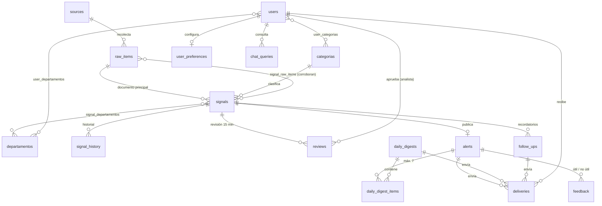

# Base de datos ORBITA (PostgreSQL / Supabase)

Esquema para la beta de 30 días del sistema de alertas turísticas de Bolivia. Probado en PostgreSQL 16 con pgvector; compatible con Supabase (PostgreSQL 15+).

## Archivos

| Archivo | Qué hace |
| --- | --- |
| `01_orbita_schema.sql` | Esquema `orbita` completo: 23 tablas, reglas en triggers, funciones para n8n, vistas, RLS y datos semilla (9 departamentos, 8 categorías, 14 fuentes, parámetros). |
| `02_base_conocimiento_pgvector.sql` | Opcional. Base de conocimiento para Hermes con embeddings (pgvector, 1536 dimensiones) y búsqueda semántica. |
| `99_prueba_flujo.sql` | Prueba del flujo completo (recolección → revisión → alerta → envío → resumen). Termina en `ROLLBACK`, no deja datos. |

## Instalación

```bash
psql "$DATABASE_URL" -v ON_ERROR_STOP=1 -f 01_orbita_schema.sql
psql "$DATABASE_URL" -v ON_ERROR_STOP=1 -f 02_base_conocimiento_pgvector.sql   # opcional
psql "$DATABASE_URL" -v ON_ERROR_STOP=1 -f 99_prueba_flujo.sql                 # comprobar
```

En **Supabase**: SQL Editor → pegar `01` → Run. Activar la extensión `vector` antes de `02`. Para que la web lea por la API REST, añadir `orbita` en *Settings → API → Exposed schemas*.

**n8n** se conecta con el usuario `postgres` (o la `service_role` key), que salta RLS. Para que el historial registre qué workflow hizo el cambio: `SET LOCAL orbita.actor = 'n8n:analisis-hermes';`

## Diagrama



Además: `parametros` (reglas editables), `system_logs` (logs y costos de n8n), `audit_log` (cambios de usuarios, fuentes, categorías y parámetros), y en `02` `kb_documents` / `kb_chunks`.

## Cómo se reflejan las reglas de la especificación

| Regla | Dónde |
| --- | --- |
| Estados detectada → en_analisis → en_verificacion → confirmada → publicada → cerrada / descartada | Enum `estado_senal`; un trigger rechaza saltos no permitidos (p. ej. detectada → publicada). |
| Revisión obligatoria en salud, clima, vial, seguridad, fuentes no oficiales y escenarios | `categorias.revision_obligatoria` + trigger que marca `signals.requiere_revision`. |
| SLA de 15 min en horario de guardia (07:00–22:00 Bolivia) | `reviews.vence_en` se calcula con `calcular_vencimiento()`; fuera de guardia vence a las 07:15. Valores en `parametros`. |
| Sin aprobación a tiempo → "en verificación" solo con aviso oficial enlazado | `vencer_revisiones()` devuelve `publicar_en_verificacion` o `escalar_al_administrador`. Una alerta "en verificación" sin enlace es rechazada por constraint. |
| Todo lo que va por WhatsApp debe estar aprobado | Trigger en `deliveries` bloquea el envío por WhatsApp de alertas sin `aprobada_por`. |
| Resumen diario de máximo 7 | `daily_digest_items.orden` entre 1 y 7 (la BD no deja meter una 8.ª); `generar_resumen_diario()` elige las 7 mejores. |
| Usuario elige temas y departamentos | `user_categorias`, `user_departamentos` (sin filas = todos); `destinatarios_alerta(alerta, canal)` devuelve a quién enviar y evita duplicados por versión. |
| Actualizar alerta y guardar historial | `alerts.version` sube sola al cambiar el texto; los cambios de señal y alerta quedan en `signal_history`. |
| Predicciones etiquetadas como escenario, privadas al inicio | `es_escenario` en señal y alerta; la web pública y los visores no las ven. |
| Web pública / gestión privada | Vista `v_alertas_publicas` para `anon`; RLS: administrador y analista ven todo, visor solo lo suyo y las alertas públicas. |
| Feedback útil / no útil | `feedback`, un voto por usuario (o por visitante anónimo en la web). |
| Recordatorios 30/15/5 (convocatorias) y 90/60/30 (eventos) | `programar_recordatorios(señal)` llena `follow_ups`. |
| Retención 6 meses | `purgar_retencion()`; programar a diario con n8n o con pg_cron en Supabase: `select cron.schedule('purga-orbita', '0 4 * * *', 'select * from orbita.purgar_retencion()');` |
| Dedupe por hash | `raw_items.content_hash` único → `INSERT ... ON CONFLICT (content_hash) DO NOTHING`. |

## Funciones que llama n8n

| Workflow | Llamada |
| --- | --- |
| 1 Recolección | `INSERT INTO orbita.raw_items (...) ON CONFLICT (content_hash) DO NOTHING` |
| 3 Análisis Hermes | `INSERT INTO orbita.signals (...)`, `signal_departamentos`; luego `SELECT orbita.solicitar_revision(id)` si `requiere_revision` |
| 4 Revisión humana | `SELECT * FROM orbita.v_cola_revision`; `SELECT orbita.decidir_revision(review_id, analista_id, 'aprobada')`; cada minuto `SELECT * FROM orbita.vencer_revisiones()` |
| 5 Envío | `SELECT * FROM orbita.destinatarios_alerta(alert_id, 'telegram')` → `INSERT INTO orbita.deliveries` |
| 6 Resumen diario | `SELECT orbita.generar_resumen_diario()` |
| 7 Consulta por chat | `v_alertas_publicas` filtrada por departamento/categoría; registrar en `chat_queries` |
| 8 Recordatorios | `SELECT orbita.programar_recordatorios(signal_id)`; enviar los `follow_ups` con `programado_para <= now()` |
| Métricas semanales | `v_metricas_diarias`, `v_estado_fuentes` |

## Para revisar

- Las 8 categorías y las URLs de las fuentes de semanas 3–4 son una propuesta; se editan en `categorias` y `sources`.
- Los valores marcados como "ajuste propuesto" (guardia 07:00–22:00, escenarios privados, "en verificación" solo con enlace oficial) están en `parametros` o en `vencer_revisiones()` y se cambian sin tocar tablas.
- La hora del resumen (`resumen_hora = 08:00`) sigue pendiente de confirmar.
